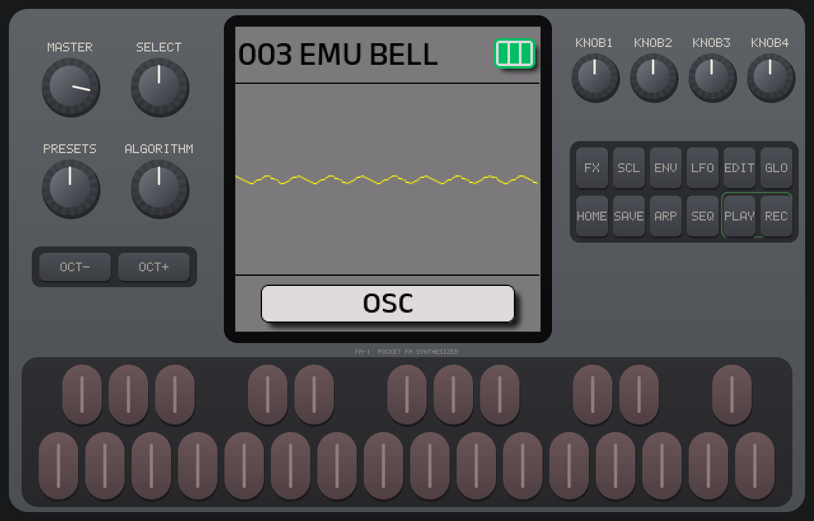

# FM-1 pour iPhone

Une application iPhone / iPad qui **émule le matériel du M-VAVE FM-1** et y fait tourner **le firmware officiel de M-VAVE, sans modification**. Ce n'est pas une imitation du synthétiseur : c'est la machine elle-même (sa puce JieLi AC791N avec ses deux cœurs, son écran 240 × 240, ses 27 touches, ses 14 boutons, ses 7 encodeurs, le potentiomètre MASTER, sa sortie audio et sa mémoire flash) recréée en logiciel. Les menus, les 128 sons, l'arpégiateur, le séquenceur, les effets et l'import de banques DX7 sont donc **exactement ceux du FM-1**, puisque c'est le même code qui s'exécute.



## Ce que fait l'application

- **Démarre sur le firmware d'origine V15** (`FM-1_015.fwsc`), intégré à l'application.
- **Façade tactile multipoint** : clavier (avec glissando d'une touche à l'autre), boutons OCT−/OCT+, FX, SCL, ENV, LFO, EDIT, GLO, HOME, SAVE, ARP, SEQ, PLAY, REC ; encodeurs SELECT, PRESETS, ALGORITHM et KNOB 1-4 (glisser vers le haut ou la droite = sens horaire) ; MASTER.
- **Mise à jour du firmware comme sur la machine** : avec les mêmes fichiers de mise à jour `.fwsc`, depuis Fichiers, AirDrop, Mail, ou une adresse web. Ça marche avec les mises à jour officielles de M-VAVE, avec FM1 Open (le firmware open source de M-VAVE) et avec les firmwares de la communauté (Felucca, X0X, SLOOP, etc.). Retour au V15 d'origine en un geste.
- **Mémoire conservée** : tout ce que le firmware enregistre dans sa flash (presets sauvés avec SAVE, réglages, séquences) est gardé d'un lancement à l'autre, séparément pour chaque firmware.
- **Import de banques DX7** (`.syx`, 32 voix) dans la bibliothèque du firmware, comme l'outil d'import de sons de M-VAVE.
- **Sauvegardes `.fm1save`**, au même format que l'émulateur web et le plug-in FM-1 pour Mac : une sauvegarde passe de l'iPhone au navigateur et inversement.
- **MIDI** : tous les claviers MIDI de l'iPhone (USB, Bluetooth, réseau) et les autres apps (port virtuel « FM-1 ») jouent la machine par sa prise MIDI IN. Le firmware de M-VAVE écoutant le canal 2 à cette entrée, le réglage « Automatique » y envoie les notes.
- **Clavier physique** (iPad, clavier Bluetooth) : rangée A S D F G H J K L ; ' pour les touches blanches à partir de Fa, W E R Y U O P pour les noires.
- Son en arrière-plan, latence réglable, voyant de vitesse d'émulation.

## Construire et installer (sur un Mac)

Il faut un Mac avec **Xcode**, **Rust** et **XcodeGen** :

```bash
curl https://sh.rustup.rs -sSf | sh     # Rust, une seule fois
brew install xcodegen                   # XcodeGen, une seule fois
./build.sh                              # moteur pour iPhone + projet Xcode
open App/FM1.xcodeproj
```

Dans Xcode : cible **FM1** → *Signing & Capabilities* → choisissez votre équipe (un identifiant Apple gratuit suffit ; l'app doit alors être réinstallée tous les 7 jours, ou un an avec un compte développeur payant). Branchez l'iPhone, sélectionnez-le, puis **⌘R**. Au premier lancement, iOS demande d'autoriser le développeur dans *Réglages → Général → VPN et gestion de l'appareil*.

Si l'identifiant `io.github.pjac1810.fm1` est refusé (déjà pris), changez-le dans `App/project.yml` puis relancez `./build.sh`.

## Mettre à jour le firmware

Comme sur le FM-1, une mise à jour est un fichier `.fwsc` :

1. Téléchargez le fichier (par exemple sur m-vave.com, rubrique téléchargements du FM-1, ou sur la page GitHub d'un firmware).
2. Ouvrez-le avec l'app FM-1 (depuis Fichiers, AirDrop ou Mail), ou dans l'app : ⚙︎ → *Mettre à jour depuis un fichier .fwsc…* ou *…depuis une adresse web…*.
3. Confirmez : la machine redémarre sur le nouveau firmware.

Chaque firmware installé reste dans la liste : on passe de l'un à l'autre en touchant son nom, et chacun retrouve sa propre mémoire. *Revenir au firmware d'origine V15* remet la machine telle qu'elle sort de la boîte (sans effacer la mémoire du V15 ; pour cela, *Effacer la mémoire de ce firmware…*).

## Performances : à lire

iOS n'autorise pas une app à générer du code exécutable. Le processeur du FM-1 est donc **interprété** instruction par instruction, ce qui demande beaucoup au processeur de l'iPhone (sur ordinateur, l'émulateur compile ce code et va plusieurs fois plus vite).

Mesuré sur un serveur Intel Xeon à 2,1 GHz (un cœur), avec ce même moteur : environ 1× le temps réel en jeu léger, environ 0,6× sur un accord de cinq notes avec le firmware V15. Un cœur performance d'iPhone récent est sensiblement plus rapide qu'un tel cœur de serveur ; on peut donc attendre de l'ordre de 1,3 à 2× le temps réel sur un iPhone 14 Pro ou plus récent, mais **cela n'a pas encore été vérifié sur un iPhone réel**. Le voyant à droite de l'écran l'indique : vert, l'émulation suit sans peine ; orange, juste ; rouge, le son décroche. En cas de craquements, augmentez le tampon audio (⚙︎ → Audio). Sur un iPhone plus ancien, les accords très chargés peuvent dépasser ce que l'interpréteur arrive à suivre.

## Ce qui n'est pas émulé

- Le FM-1 vu **comme périphérique** USB-MIDI ou Bluetooth MIDI par un ordinateur, et la sortie MIDI du firmware. L'entrée MIDI (prise MIDI IN) est émulée.
- Le haut-parleur et la batterie : le son sort par l'iPhone, l'indicateur de batterie reste plein.
- La vélocité des touches tactiles : chaque touche est jouée comme sur la façade du FM-1.

## Organisation du projet

```
build.sh                    construit le moteur et le projet Xcode (Mac)
App/
  project.yml               description du projet pour XcodeGen
  Sources/
    FM1App.swift            point d'entrée
    Engine/
      Emulator.swift        démarrage, mises à jour, sauvegardes, MIDI, statistiques
      FirmwareLibrary.swift firmwares installés, mémoire flash par firmware, format .fm1save
      AudioOutput.swift     sortie audio (AVAudioEngine)
      MIDIInput.swift       entrée MIDI (CoreMIDI, MIDI 2.0 → octets MIDI 1.0)
      Settings.swift        préférences
    UI/
      PanelView.swift       façade tactile, écran à 60 images/s, clavier physique
      ContentView.swift     écran principal
      SettingsView.swift    réglages, firmware, sons, sauvegardes, MIDI, audio
  Resources/
    Firmware/FM-1_015.fwsc  firmware d'origine V15 de M-VAVE
    Licenses/               licences
emu/                        le moteur d'émulation (Rust)
  crates/fm1-isa, fm1-core, fm1-soc, fm1-web   fm1-emu de Joakim Eriksson
  crates/fm1-ios            l'hôte iOS : fil d'émulation, tampon audio sans verrou,
                            sauvegarde de la flash, API C (include/fm1ios.h)
```

## Vérifications faites

Le moteur et sa couche iOS ont été compilés et testés sous Linux dans la même configuration qu'iOS (interpréteur seul, `FM1_FORCE_INTERPRETER=1`), avec le firmware V15 intégré : identification du paquet (`FM-1_015`), démarrage, écran (`001 EMU E.PNO`, puis `003 EMU BELL` après trois crans de PRESETS), son d'un accord joué au clavier et d'une note reçue en MIDI, sauvegarde de la flash, rendu et zones tactiles de la façade, interface C vérifiée depuis un programme C. Pour refaire ce test :

```bash
cd emu
FM1_FORCE_INTERPRETER=1 cargo run --release -p fm1-ios --example simulate -- ../App/Resources/Firmware/FM-1_015.fwsc
```

Le code Swift n'a pas pu être compilé ici (pas d'Xcode) : la première compilation sur le Mac peut demander de petites corrections.

## Licences et crédits

- Émulation du matériel : [fm1-emu](https://github.com/joakimeriksson/fm1-emu) de Joakim Eriksson, licence MIT (commit `93cb7ee`). Modifications pour iOS : un interrupteur `FM1_FORCE_INTERPRETER` dans `fm1-core/build.rs`, `fm1-web` compilé en bibliothèque Rust seulement, et la légende de la façade.
- Firmware V15 : © M-VAVE, distribué par M-VAVE sous licence Apache-2.0 comme image de récupération dans le kit [FM1 Open](https://github.com/m-vave/fm1_open) (V14, `sdk/firmware/FM-1_015.fwsc`, SHA-256 `db1642b2…e7edb8a`). Les conditions complètes sont dans `App/Resources/Licenses/`.
- M-VAVE et FM-1 sont des marques de leurs propriétaires. Ce projet n'est ni affilié à M-VAVE ni approuvé par M-VAVE.
